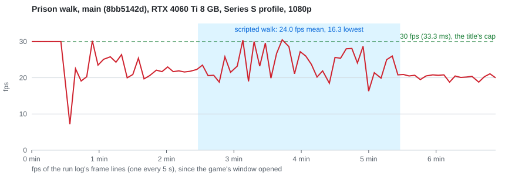
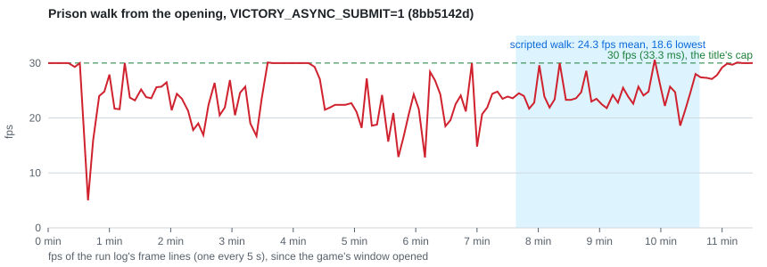

# VI-BR-PORT: the build for 8 GB cards

**English** | [Português](README.pt-BR.md)

A compatibility layer that runs, natively on Windows, the **Xbox Series X|S** build
(the *Scarlett* platform, titles made with the **GDK**) of a title, from the user's own
files. The console's x86-64 code runs unchanged inside our process; underneath it are the
console's system libraries rewritten (HLE) and a Direct3D 12 back end that recompiles the
console GPU's shaders (GFX10/RDNA2) to DXIL.

This fork has one target: an **8 GB NVIDIA card with waves of 32 lanes** (tested on an
RTX 4060 Ti) on a **1080p monitor**.

**This repository holds no files, code or assets of the game.** You need your own copy.
Nothing here is connected with, or endorsed by, the game's developer or publisher.

## Where it stands (2026-11-27)

**Playable in Lucia's prologue, in the prison**: the cell, the corridor and the common
room, up to the cutscene in the counselor's office, with the player in control, on the
Series S profile. On the development branch the story plays on from there into the first
open-world mission (the boat), at about 20 to 22 fps.

### Benchmark

Release build of commit `8bb5142d`, Series S profile, 1920x1080 window, the title's own
upscaler. PC: RTX 4060 Ti 8 GB (driver 621.40), i7-13700K, 64 GB of RAM, Windows 11.
Measured on 2026-11-26, on one machine; nobody else has reproduced it yet.

| Scene | How it was measured | Result |
|---|---|---|
| Prison, walking | a scripted 3-minute walk (keys through `VICTORY_KEYS_FILE`) from the cell's save; the mean of the run log's frame lines | **24.0 fps** (lowest line 16.3) |
| Prison, walking, coming from the opening | the same walk, 470 s after the game opens | 22.9 fps (lowest line 14.4) |
| Prison, walking, with `VICTORY_ASYNC_SUBMIT=1` | the same walk | 24.3 fps (lowest line 18.6) |
| Prison, standing still in the cell | the log's frame lines, 35 s in a row | **30.0 fps** (33.3 ms, the title's cap)¹ |
| Opening cutscene, 3D part | 40 to 75 s after the window opens | 21.2 fps |
| Opening video | | 30 fps |

¹ measured on the hair test branch, one commit ahead of this one.

Walking in the prison the card is 93 to 97% busy: the GPU is the limit there. The goal is
a steady 33 ms (30 fps).

What each change of this fork measured, before and after, with its commit:
[docs/BENCHMARKS.md](docs/BENCHMARKS.md).

The frame rate over a whole run, from the log's own frame lines (the blue band is the
scripted walk):





The charts are drawn from the logs; this repository keeps no pictures of the game
([docs/asset-policy.md](docs/asset-policy.md)).

**Stability:** no crash and no device removal in the runs of 2026-11-26 with the settings
below (more than 30 runs of 7 to 12 minutes). Long sessions have not been measured yet.

**Known picture problems:** fog far too thick in the prison's common room; in an
occasional frame the walls vanish or the interior light goes out; the window glass is not
drawn (the card refused the transmission shader; fixed on the development branch); the
guard's tattooed arm comes out in a wrong colour; 35 programs of lighting, shadows and fog
are still translated approximately on 32-lane cards; in the open world the boat comes out
unlit and the sea shows black rectangles near the horizon.

## What this fork adds

- **`VICTORY_RT_MISS=1`**: the ray test hits nothing; without the ray-tracing structure
  built, the shadows of local lights came out as garbage (black or "glittering" faces).
- **The ray-tracing skinning is left out** with `RT_MISS=1`: the 30 `CSComputeSkinning*`
  programs (`bvh_skinning`) redid every character's pose only for the ray-tracing
  structure, which nobody uses that way, and were most of the card's time (about 6.8 to
  10.9 fps on Series S). `VICTORY_RT_SKIN=1` runs them again.
- **The face decoration bake is known by name** (`PS_DecorationBlend_*`,
  `PS_BakeDecorations_*`, 51 programs): the list of 4 hashes left out the ones that make
  the cutscene's faces, and the faces came out black.
- **Lists of changed memory are compacted, not cleared,** when they fill up: clearing
  left textures with old bytes after the memory changed.
- **The present's planes are composed** (Series S: the world and the interface in separate
  planes), sent ahead like a single-plane present, without waiting for the card.
- **Mouths and facial expressions**: the network that animates faces keeps its values in
  16-bit buffers, which the translation read as zeros through descriptor tables; they are
  now moved as 16-bit integers and mouths open and close with the lines.
- **Exact cascade shadows on 32-lane cards** (NVIDIA), and **texture views written by the
  card** copied from the texture itself.
- **A "Brazil | VIctory" window** with the fork's logo (`VICTORY_ICON`), and
  **`VICTORY_KEYS_FILE`**: a key written to a file is pressed in the game without focus
  (for scripts that get past the terms and the account picker, and for scripted walks).
- **The opening video no longer steps back**: each list has its own upload buffer for the
  video planes the CPU writes; with several frames in flight one frame overwrote the
  one before, and the opening's titles came back in the middle of a fade.
- **A new texture shows only after its upload** (`VICTORY_SHOW_AFTER`, now on; `0` turns
  it off): a reused piece of the pool showed old bytes, and the car seat of the opening
  became a green and blue checkerboard.
- **Title patches in release builds too** (`VICTORY_UPSCALER=6`: the title's own upscaler
  on Series S, since the FidelityFX passes have no DXIL here).
- **Pipelines**: a 64 MB stack for the NVIDIA driver's compiler, compute pipelines started
  at creation, a 500 ms wait only in the first 60 frames (8 ms after), and a late
  pipeline holding up only the first frame that asks for it.
- **wave64 on 32-lane cards**: programs that would ask for 64-lane waves take the
  wave-wide form.
- **DirectStorage** writes to read-only pages as the console's engine does.
- `VICTORY_NO_WATCHDOG`, `VICTORY_NULL_MAGENTA` (diagnostics) and the cap of 262,144
  remapped ranges.

## How to run

```powershell
copy victory.example.toml victory.toml      # and point game_dir at your copy
cargo build --locked --release -p victory
target\release\victory.exe shaders <the game's shader files>
target\release\victory.exe run <the game's executable> --console series-s --execute
```

Settings used for the measurements above: `VICTORY_RT_MISS=1`, `VICTORY_RELAY=2`,
`VICTORY_CARD_STEPS=2`, `VICTORY_THIN=0`, `VICTORY_DISPLAY_MODE=1920x1080`,
`VICTORY_PIPELINE_BOOK=1`, `VICTORY_MEMORY_CARD_MB=1024`, `VICTORY_UPSCALER=6`,
`VICTORY_AMBIENT=constant:0.1`, `VICTORY_AMBIENT_AIR=0.8`, `VICTORY_CARD_BUFFERS_MIN_KB=64`,
`VICTORY_PORT_CONSTANTS=1` (Series S). Do not turn `VICTORY_THIN=1` on with an NVIDIA
card (the frame rate falls to less than half).
`VICTORY_AMBIENT=constant:0.1`: without rays, the indirect-light probes leave coloured
blocks on the walls (the purple patch in the cell); a constant, faint indirect light
removes the blocks and keeps the night dark. The estimate (`VICTORY_AMBIENT=<number>`)
posterizes walls and skin, and high constant levels make the night as bright as day.

## License

GPL-3.0-or-later, like VIctory. See [LICENSE](LICENSE).
