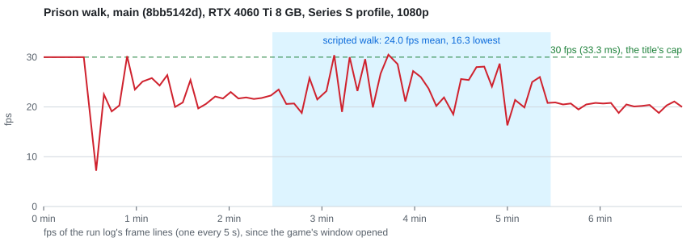
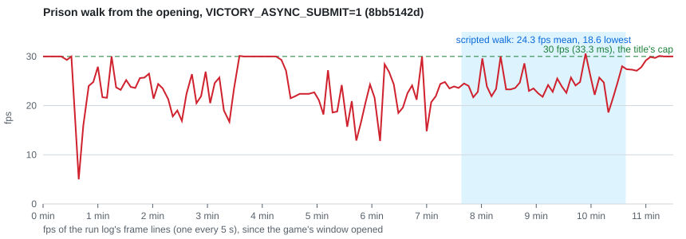

# VI-BR-PORT: a versão para placas de 8 GB

[English](README.md) | **Português**

Camada de compatibilidade que roda no Windows, de forma nativa, a versão de
**Xbox Series X|S** (plataforma *Scarlett*, jogos feitos com o **GDK**) de um
título, a partir dos arquivos do próprio usuário. O código x86-64 do console
roda sem alteração dentro do nosso processo; por baixo dele ficam as bibliotecas
do sistema do console reescritas (HLE) e um back-end Direct3D 12 que recompila
os shaders da GPU do console (GFX10/RDNA2) para DXIL.

Este fork tem um alvo só: **placa NVIDIA de 8 GB com ondas de 32 lanes**
(testado numa RTX 4060 Ti) ligada a um **monitor 1080p**.

**Este repositório não contém arquivos, código ou recursos do jogo.** É preciso
ter a sua própria cópia. Nada aqui tem ligação com o desenvolvedor ou a
editora do jogo, nem é aprovado por eles.

## Onde está (2026-11-27)

**Jogável no prólogo da Lucia, na prisão**: a cela, o corredor e a sala comum, até a cutscene do escritório
da conselheira, com o jogador no controle, no perfil Series S. No ramo de desenvolvimento a
história segue dali até a primeira missão em mundo aberto (o barco), a cerca de 20 a 22 fps.

### Benchmark

Build release do commit `8bb5142d`, perfil Series S, janela 1920x1080, upscaler do próprio
jogo. PC: RTX 4060 Ti 8 GB (driver 621.40), i7-13700K, 64 GB de RAM, Windows 11. Medido em
26/11/2026, numa máquina só.

| Cena | Como foi medido | Resultado |
|---|---|---|
| Prisão, andando | caminhada de 3 min por script (teclas pelo `VICTORY_KEYS_FILE`), a partir do save da cela; média das linhas de quadro do log | **24,0 fps** (pior linha 16,3) |
| Prisão, andando, vindo da abertura | a mesma caminhada, 470 s depois de abrir o jogo | 22,9 fps (pior linha 14,4) |
| Prisão, andando, com `VICTORY_ASYNC_SUBMIT=1` | a mesma caminhada | 24,3 fps (pior linha 18,6) |
| Prisão, personagem parada na cela | linhas de quadro do log, 35 s seguidos | **30,0 fps** (33,3 ms, o teto do jogo)¹ |
| Cutscene 3D da abertura | 40 a 75 s depois de abrir a janela | 21,2 fps |
| Vídeo da abertura | | 30 fps |

¹ medido no ramo de teste do cabelo, um commit à frente deste.

Andando na prisão a placa fica 93 a 97% ocupada: o limite ali é a GPU. O alvo é 33 ms
(30 fps) estáveis.

O que cada mudança deste fork mediu, antes e depois, com o commit de cada uma:
[docs/BENCHMARKS.md](docs/BENCHMARKS.md).

O fps ao longo de uma rodada inteira, das linhas de quadro do próprio log (a faixa azul é a
caminhada por script):





Os gráficos são gerados dos logs; este repositório não guarda capturas do jogo
([docs/asset-policy.md](docs/asset-policy.md)).

**Estabilidade:** nenhuma queda nem perda da placa nas rodadas de 26/11 com a configuração
abaixo (mais de 30 rodadas de 7 a 12 minutos). Sessões longas ainda não foram medidas.

**Problemas conhecidos de imagem:** neblina grossa demais na sala comum; num quadro
ocasional as paredes somem ou a luz interna apaga; o vidro das janelas não é desenhado
(o shader de transmissão era recusado pela placa; corrigido no ramo de desenvolvimento);
a tatuagem do braço do guarda sai com cor errada; 35 programas de luz, sombra e neblina
ainda são traduzidos de forma aproximada em placas de 32 lanes; no mundo aberto o barco sai
sem luz e o mar mostra retângulos pretos perto do horizonte.

## O que este fork acrescenta

- **`VICTORY_RT_MISS=1`**: o teste de raio não acerta nada; sem a estrutura de ray
  tracing montada, as sombras de luzes locais saíam de lixo (rosto preto ou com "purpurina").
- **Skinning do ray tracing pulado** com `RT_MISS=1`: os 30 programas `CSComputeSkinning*`
  (`bvh_skinning`) refaziam a pose de todo personagem só para a estrutura de ray tracing,
  que ninguém usa assim, e eram a maior parte do tempo da placa (~6,8 → ~10,9 fps no
  Series S). `VICTORY_RT_SKIN=1` volta a rodá-los.
- **Assado de decoração do rosto reconhecido pelo nome** (`PS_DecorationBlend_*`,
  `PS_BakeDecorations_*`, 51 programas): a lista de 4 hashes deixava de fora o que
  faz os rostos da cutscene, e o rosto saía preto.
- **Listas de memória alterada compactadas em vez de apagadas** quando enchem: apagar
  deixava texturas com bytes velhos depois de a memória mudar.
- **Composição de planos do present** (Series S: o mundo e a interface em planos separados),
  enviada à frente como o present de um plano só, sem esperar a placa.
- **Boca e expressões dos rostos**: a rede que anima os rostos guarda os valores em buffers
  de 16 bits e a tradução os lia como zero nas tabelas de descritores; agora são movidos
  como inteiros de 16 bits e a boca abre e fecha nas falas.
- **Sombras em cascata exatas em placas de 32 lanes** (NVIDIA) e **views de textura
  escritas pela placa** copiadas da própria textura.
- **Janela "Brazil | VIctory"** com a logo do fork (`VICTORY_ICON`) e
  **`VICTORY_KEYS_FILE`**: uma tecla escrita num arquivo é apertada no jogo sem precisar
  de foco (para scripts que passam pelos termos e pelo seletor de conta).
- **Vídeo da abertura sem voltar quadros**: cada lista tem o seu próprio buffer de upload
  para os planos de vídeo escritos pela CPU; com vários quadros em voo, um quadro
  sobrescrevia o anterior e os letreiros da abertura voltavam no meio do fade.
- **Textura nova só aparece depois do upload** (`VICTORY_SHOW_AFTER`, agora ligado; `0`
  desliga): um pedaço reaproveitado do pool mostrava bytes velhos, e o banco do carro
  da abertura virava um quadriculado verde e azul.
- **Patches do título também no release** (`VICTORY_UPSCALER=6`: o upscaler do próprio
  jogo no Series S, já que os passes do FidelityFX não têm DXIL aqui).
- **Pipelines**: pilha de 64 MB para o compilador do driver da NVIDIA, compute começando
  na criação, espera de 500 ms só nos 60 primeiros quadros (8 ms depois) e uma pipeline
  atrasada segurando só o primeiro quadro que a pede.
- **wave64 em placas de 32 lanes**: programas que pediriam ondas de 64 lanes usam a forma larga.
- **DirectStorage** grava em páginas somente leitura como o motor do console.
- `VICTORY_NO_WATCHDOG`, `VICTORY_NULL_MAGENTA` (diagnóstico) e o teto de 262.144
  faixas remapeadas.

## Como rodar

```powershell
copy victory.example.toml victory.toml      # e aponte game_dir para a sua cópia
cargo build --locked --release -p victory
target\release\victory.exe shaders <os arquivos de shaders do jogo>
target\release\victory.exe run <o executável do jogo> --console series-s --execute
```

Configuração usada nas medições acima: `VICTORY_RT_MISS=1`, `VICTORY_RELAY=2`, `VICTORY_CARD_STEPS=2`,
`VICTORY_THIN=0`, `VICTORY_DISPLAY_MODE=1920x1080`, `VICTORY_PIPELINE_BOOK=1`,
`VICTORY_MEMORY_CARD_MB=1024`, `VICTORY_UPSCALER=6`, `VICTORY_AMBIENT=constant:0.1`,
`VICTORY_AMBIENT_AIR=0.8`, `VICTORY_CARD_BUFFERS_MIN_KB=64`, `VICTORY_PORT_CONSTANTS=1` (Series S). Não ligue
`VICTORY_THIN=1` numa NVIDIA (o fps cai a menos da metade).
`VICTORY_AMBIENT=constant:0.1`: sem raios, as sondas de luz indireta deixam blocos
coloridos nas paredes (a mancha roxa da cela); uma luz indireta constante e fraca tira
os blocos e mantém a noite escura. A estimativa (`VICTORY_AMBIENT=<número>`) posteriza
paredes e pele, e níveis constantes altos deixam a noite clara como dia.

## Licença

GPL-3.0-or-later, como o VIctory. Ver [LICENSE](LICENSE).
